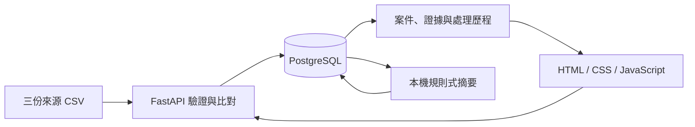

# 跨系統對帳與異常追查平台

使用 Python、FastAPI 與 PostgreSQL，將訂單、付款與結算 CSV 整合成可追溯的異常案件，提供原始證據、處理歷程與本機規則式摘要。

**面試展示入口：** [五分鐘展示與問答](docs/interview-guide.md) · [架構與設計取捨](docs/architecture.md)

## 解決的問題

客戶已付款，訂單卻顯示未付款；IT 需要跨三份資料核對編號、金額與時間，再整理調查依據。
本專案把這個流程實作為「上傳 → 驗證 → 比對 → 證據 → 調查與結案」的本機工作台。

範例：S8004 的結算總額 2000、手續費 40，紀錄淨額卻是 1970。
平台指出應有淨額 1960、差額 +10，並保留 settlements.csv 第 4 列與對應付款資料作為證據。

此作品使用合成資料，定位為可重現的本機原型；尚未接入真實企業或金融機構系統。

## 已實作功能

- 三份 CSV 同時上傳，驗證欄位、型別、金額、幣別與資料關聯。
- 四種比對：訂單狀態未更新、付款金額不符、結算缺漏、結算算式不符。
- 保存原始檔案、SHA-256、原始列與列號，以及可查詢的型別化資料。
- 相同來源、設定與規則版本可重複匯入，沿用既有結果與案件進度。
- 批次與案件查詢、異常類型／處理狀態篩選、分頁及證據側欄。
- 待處理、調查中、已結案；追加備註、結案時間與版本衝突檢查。
- 本機規則式摘要：整理事實、證據引用、固定查核步驟與尚缺資料。

**目前摘要不呼叫外部模型，不需 API 金鑰或額度。**
歷史 AI 串接與模擬測試保留，外部 AI 產生預設停用；尚未成功驗證真實模型摘要。

## 三分鐘看懂範例

| 訂單 | 異常 | 要展示的技術重點 |
|---|---|---|
| O1001 | 付款成功，但訂單快照仍為 UNPAID | 比對時間、同步等待期與原始列追溯 |
| O1002 | 訂單 1500、付款 1400 | Decimal 精確差額 -100 |
| O1003 | P9003 預期 11/16 結算，完整範圍內查無紀錄 | 涵蓋日期、查無紀錄證據，避免把未取得資料當成缺漏 |
| O1004 | 2000 − 40 不等於紀錄淨額 1970 | 算式驗證、證據引用與後續處理 |

另有正常交易、未到期付款、失敗付款與尚未付款訂單，用來檢查誤報。
資料共 8 筆訂單、7 筆付款、4 筆結算；預期四筆異常。

## 系統架構



詳見 [架構、資料關係與 API](docs/architecture.md)。

| 技術 | 用途 |
|---|---|
| Python 3.11、Decimal | CSV 處理、四條規則與精確金額 |
| FastAPI、Pydantic | 上傳、API、資料驗證與互動文件 |
| PostgreSQL 17、Psycopg 3 | 原始資料、結果與歷程；交易、唯一鍵與列鎖 |
| HTML、CSS、原生 JavaScript | 本機網頁、篩選、上傳與證據側欄 |
| unittest、TestClient | 規則、API 與資料庫整合測試 |

## 在本機啟動

已驗證環境：macOS Apple Silicon、Python 3.11、PostgreSQL 17。
以下從包含 pyproject.toml 的專案根目錄執行。首次安裝依賴需要網路。

```bash
python3.11 -m venv .venv
source .venv/bin/activate
python -m pip install -r requirements-lock.txt
python -m pip install --no-deps -e .
```

若尚未安裝 PostgreSQL，可在已有 Homebrew 的 Mac 執行：

```bash
brew install postgresql@17
```

初始化專案專用的本機資料庫並匯入範例：

```bash
python -m scripts.local_postgres setup
python -m scripts.db init
python -m scripts.db import-sample
python -m uvicorn app.main:app --host 127.0.0.1 --port 8000
```

setup 自動產生隨機密碼與 .env；不必先複製 .env.example。
在已完成 setup 的電腦，日後用 `python -m scripts.local_postgres start` 啟動即可。

- 工作台：http://127.0.0.1:8000/
- API 文件：http://127.0.0.1:8000/docs
- 程序健康檢查：http://127.0.0.1:8000/health

範例 CSV 在 data/sample。上傳時使用固定條件：

| 設定 | 範例值 |
|---|---|
| 比對基準 | 2026-11-17T09:00:00+08:00 |
| 結算資料完整涵蓋至 | 2026-11-16（含） |
| 訂單同步等待 | 15 分鐘 |

停止 API：在其終端機按 Control+C。
停止資料庫但保留資料：`python -m scripts.local_postgres stop`。

其他作業系統需自行建立 PostgreSQL 並設定 DATABASE_URL；內附管理腳本主要針對 Mac，尚未驗證跨平台安裝。

## 驗證

資料庫啟動後，執行完整測試：

```bash
RUN_DATABASE_TESTS=1 python -m unittest discover -s tests -v
```

目前預期 `Ran 115 tests`、`OK`。其中 29 項為 PostgreSQL 整合測試，使用獨立暫存 schema。
2026-11-17 已完整執行通過。測試中的外部 AI 回應使用 mock，不消耗模型額度。

不連資料庫時可執行：

```bash
python -m unittest discover -s tests -v
```

預期 86 項通過、29 項略過。這些是功能驗證，尚無大規模效能或正式環境服務水準數據。

## 重要設計與範圍

- 來源與結果用單一交易保存，任一步失敗就回復。
- 金額使用 Decimal／NUMERIC；輸出字串保留十進位精確度。
- 結算缺漏須同時滿足逾期、查無資料與來源宣告完整涵蓋。
- 狀態變更先鎖定案件並檢查 expected_version，舊分頁更新回傳 409。
- 比對結果與人工處理狀態分開；結案後仍保留歷史異常與證據。
- 摘要依已知規則產生，不代替人工查核或直接修改來源資料。

目前單一 TWD、每張訂單最多一筆成功付款，尚未支援退款、分期、登入權限、背景大量處理或跨批次案件合併。

## 專案結構

```text
app/                 API、比對、資料保存、摘要與網頁
sql/                 001～004 資料庫 migration
scripts/             本機資料庫管理、CLI 與作品包匯出
tests/              規則、API 與 PostgreSQL 測試
data/sample/         合成 CSV 與預期結果
docs/                操作、架構與面試展示指南
```

## 展示與交付

- [五分鐘展示、履歷草稿與面試問答](docs/interview-guide.md)
- [架構與設計取捨](docs/architecture.md)
- [規則式摘要操作](docs/rule-summary-step-by-step.md)
- [案件狀態與備註操作](docs/case-workflow-step-by-step.md)
- [網頁操作](docs/web-step-by-step.md)
- [API 操作](docs/api-step-by-step.md)
- [資料庫建置](docs/postgresql-step-by-step.md)
- [原逐步開發說明](docs/development-walkthrough.md)

產生原始碼作品包：

```bash
python -m scripts.export_portfolio
```

輸出為 dist/reconcile-platform-portfolio.zip，只包含明確允許的原始碼、範例資料與文件。
.env、.local 資料庫目錄、.venv、Git 目錄與 dist 不會被匯入作品包。
作品包不是已部署服務，首次啟動仍需依前述步驟安裝環境。

## 開發方式

使用 GPT 協助拆解需求、產生初版實作、測試與文件，並以實際操作及自動測試驗證。
面試時應依自己能解釋的部分描述貢獻，並清楚區分已驗證功能與尚未完成的能力。
