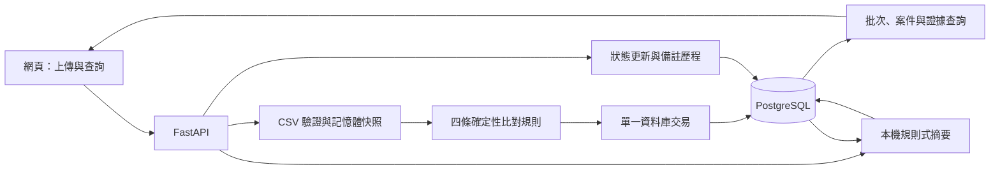
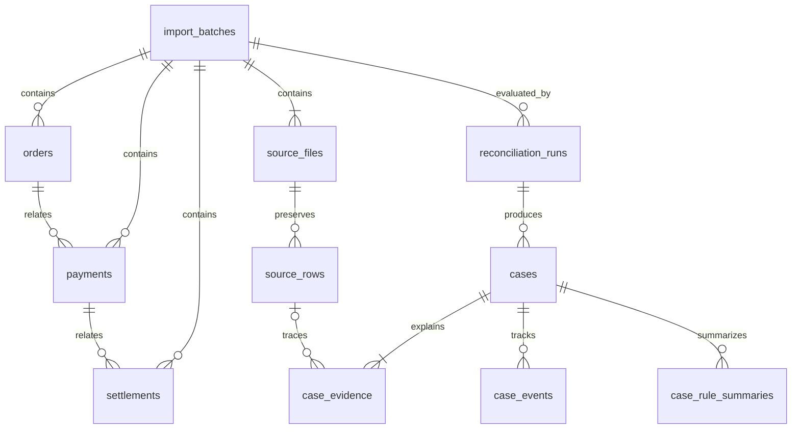

# 架構與設計取捨

## 資料流程

上傳時先在記憶體驗證與比對，確認完成後才保存來源與結果。
現階段不是從資料庫重載全部來源再批次比對，亦未使用背景工作佇列。

## 主要資料關係

這是概念關係圖。實際訂單、付款與結算的關聯以 batch_id 加上業務編號組成，避免不同快照互相混用。
查無紀錄的證據沒有 source_row_id，因此 source_rows 關係可為空。
歷史 AI 摘要另存 case_ai_summaries，目前首頁使用獨立的 case_rule_summaries。

## 關鍵設計

| 決策 | 目的 | 代價或限制 |
|---|---|---|
| 保存原始檔與型別化資料 | 同時支援追溯與 SQL 查詢 | 原始資料與整理資料都需要儲存空間 |
| Decimal 與 NUMERIC(18,2) | 精確比較金額並驗證範圍 | 只支援目前定義的小數位與幣別 |
| 來源快照指紋＋規則版本＋設定雜湊 | 可重複匯入，保留不同版本結果 | 修改規則時需正確更新規則版本 |
| 整次匯入使用單一交易 | 失敗時不留下部分來源與案件 | 現階段不支援錯誤列隔離後部分成功 |
| 案件狀態獨立於偵測結果 | 結案後仍可保留原始異常與證據 | 案件數與未結案數不能視為相同指標 |
| 列鎖＋expected_version | 避免舊分頁覆蓋新的處理紀錄 | 衝突時使用者需重新核對後送出 |
| 本機固定規則摘要 | 無模型額度需求、內容可重現 | 新類型需新增範本，不推論任意未知問題 |

## API 導覽

| 方法與路徑 | 用途 |
|---|---|
| POST /api/reconciliations | 上傳三份 CSV、比對與保存 |
| GET /api/runs | 批次清單 |
| GET /api/runs/{run_id} | 比對設定與結果數 |
| GET /api/runs/{run_id}/cases | 異常清單、類型及狀態篩選、分頁 |
| GET /api/cases/{case_id} | 案件、處理歷程與證據 |
| PATCH /api/cases/{case_id} | 狀態與備註，包含版本檢查 |
| GET /api/summary/status | 確認目前為本機規則摘要 |
| GET／POST /api/cases/{case_id}/rule-summary | 讀取或產生規則式摘要 |

完整互動規格請開啟本機 /docs。/health 只表示程序能回應，不代表資料庫或所有業務功能正常。

## 測試證據

目前 115 項測試，86 項不需 PostgreSQL，29 項需本機 PostgreSQL。
完整指令：`RUN_DATABASE_TESTS=1 python -m unittest discover -s tests -v`。
2026-11-17 的完整執行結果為 `Ran 115 tests`、`OK`，使用者亦已在自己的終端機確認。

具體覆蓋：

- 15 分鐘邊界、過舊快照、台北日期換算、當天尚未到期不誤報。
- 同值不同小數格式、一分錢差額、無效金額與幣別。
- 重複檔案、並行匯入、交易失敗回復與原始證據讀回。
- CSV／API 驗證、查無資料、分頁與組合篩選。
- 結案說明、重新調查、備註歷程、版本衝突與並行更新。
- 本機摘要引用、動態金額、保存、快取與版本過期。

這些是功能測試，尚未提供大規模效能數據或正式環境服務水準。
